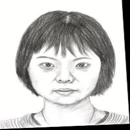
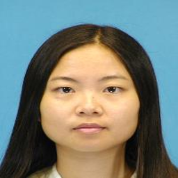
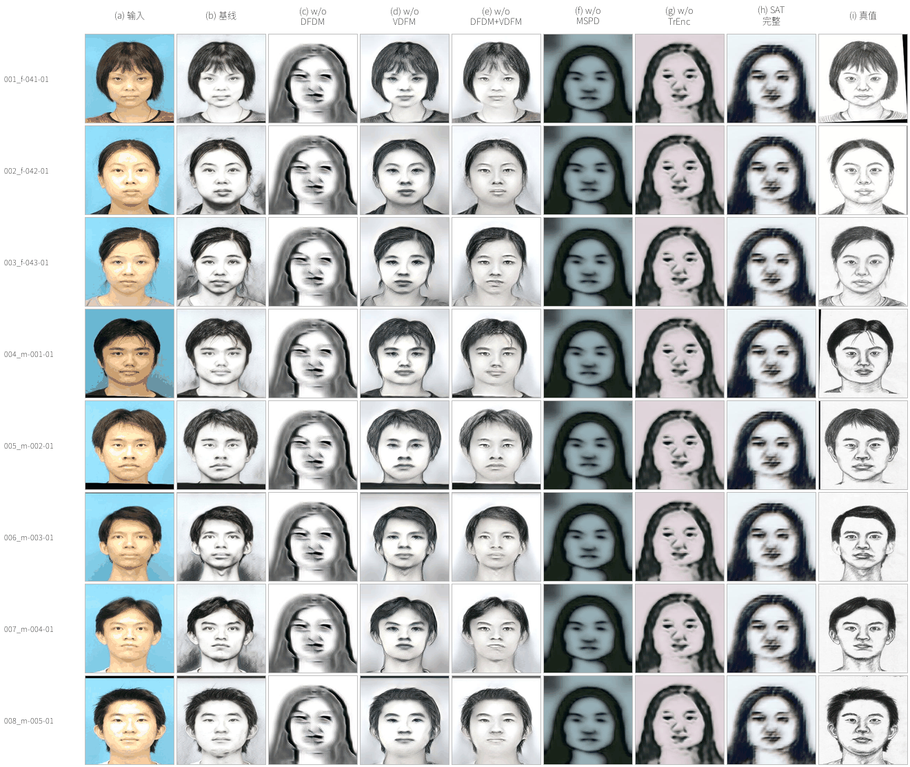

# 复现《基于空间自适应 Transformer 的人脸素描图像生成》

## 描述

使用部分数据复现论文试验方法和结果，复现脚本统一放置于 `scripts/`。

## 环境

- `venv`
- `Python 3.14.7`
- `CPU`

## 文件结构

```text
.
├── scripts                                 # 复现脚本
│   ├── prepare-cuhk.py                     # 按人脸编号配对 CUHK 数据
│   ├── dataset_cuhk.py                     # PyTorch 配对数据读取器 PairedCUHKDataset，返回 (Ic, Is) 张量
│   ├── dfdm.py                             # 双模态特征解耦模块
│   ├── vdfm.py                             # 行-列向量动态融合模块
│   ├── mspd.py                             # 多尺度感知判别器
│   ├── sat_losses.py                       # 论文 6 项加权总损失与对抗损失
│   ├── sat_model.py                        # SAT-StyTR 完整生成器（含预训练权重加载）
│   ├── train_sat.py                        # 轻量化 CPU 训练脚本（支持消融开关）
│   ├── infer_sat.py                        # 批量推理脚本（输出素描与耗时统计）
│   └── eval_metrics.py                     # 定量评估脚本（SSIM / PSNR / MSE）
├── cuhk-face-sketch-database               # 原始 CUFS 数据集
├── data
│   ├── cuhk                                # 40训/10测 数据集
│   │   ├── train
│   │   │   ├── photo
│   │   │   └── sketch                    
│   │   └── test
│   │       ├── photo                       
│   │       └── sketch                     
│   ├── baseline                            # 原版 StyTR-2 在 CUHK 上的基线试验
│   │   ├── input                           
│   │   └── output                         
│   └── sat                                 # SAT-StyTR 部分数据复现试验归档
│       ├── comparison_grid.png             # 试验结果图片对比
│       ├── input                           # README 对比用的测试输入照片
│       ├── style                           # 统一风格参考素描
│       ├── gt                              # 测试真值素描（仅对比）
│       ├── output                          # SAT-StyTR 完整模型输出
│       └── ablation                        # 消融模型输出
│           ├── no_dfdm
│           ├── no_vdfm
│           ├── no_dfdm_vdfm
│           ├── no_mspd
│           └── no_tr_enc
├── input                                   # 临时输入工作区
├── out                                     # 临时输出工作区
...
```

## 步骤

1. 构建 `StyTR-2` 环境，修改代码并使用 `test.py` 验证AMD/CPU环境可用。

2. 下载 CUFS（CUHK）数据集，仅使用 `photos/`（188 张，200×250）与 `sketches/`（188 张，200×250）。

3. 使用 `scripts/prepare-cuhk.py` 从 `photos/` 与 `sketches/` 按人脸编号精准配对，抽取 40 对训练 + 10 对测试，输出到 `data/cuhk/`。
   
   - 对应论文 **2.1 节**数据集划分（CUHK 188 对按 4:1 轻量化缩减）与 **1.5.4 节公式 (12)** 同人同尺寸约束。
   - 使用原版 `test.py` 跑 1 张测试照片 + 1 张训练素描，输入与输出归档到 `data/baseline/`，对应论文 **2.2 节图 4** 的基线对照组。
   
   | 输入照片 $I_c$                                                           | 风格参考 $I_s$（训练集）                                                    | 原版基线输出                                                                              | 测试真值素描（仅对比）                                                    |
   |:--------------------------------------------------------------------:|:------------------------------------------------------------------:|:-----------------------------------------------------------------------------------:|:--------------------------------------------------------------:|
   |  |  |  |  |

4. 使用 `scripts/dataset_cuhk.py` 构建配对数据读取器 `PairedCUHKDataset`（输出张量 `[B, 3, 256, 256]`，像素范围 `[0, 1]`）。
   
   - 对应论文 **1.1 节**双分支输入（人脸照片 $I_c$、素描图像 $I_s$）与 **1.5.4 节公式 (12)** 像素对齐要求。
   
   | 训练照片 $I_c$                                             | 对应训练素描 $I_s$                                             |
   |:------------------------------------------------------:|:--------------------------------------------------------:|
   |  |  |

5. 使用 `scripts/dfdm.py` 实现并测通 `DFDM×3`：内容分支 3 级最大池化（`3×3→2×2`）、风格分支 5 级渐进平均池化（`5×5→3×3`）、`13×13` 与 `3×3` 交替卷积、双线性插值回原尺寸后逐像素重加权，参数量 `8.95 M`。
   
   - 对应论文 **1.2 节**、**图 2**、**2.4.2 节**与 **2.4.3 节**。
   
   ```bash
   source .venv/bin/activate && python scripts/dfdm.py
   ```
   
   执行结果：
   
   ```text
   PatchEmbed 输出形状: torch.Size([1, 512, 32, 32])
   DFDM×3 总参数量: 8.95 M
   DFDM×3 输出内容特征: torch.Size([1, 512, 32, 32]) 风格特征: torch.Size([1, 512, 32, 32])
   DFDM 梯度反传成功!
   ```

6. 使用 `scripts/vdfm.py` 实现并测通 `VDFM×3`：对内容与风格特征通道拼接后做自注意力与线性投影，沿行/列做 $L_1/L_2/L_\infty$ 多范数聚合与指数门控双向融合，参数量 `14.96 M`，串联 `PatchEmbed -> DFDM×3 -> VDFM×3 -> decoder` 输出 `[1, 3, 256, 256]` 并完成梯度反传验证。
   
   - 对应论文 **1.3 节公式 (1)~(8)** 与 **图 1**。
   
   ```bash
   source .venv/bin/activate && python scripts/vdfm.py
   ```
   
   执行结果：
   
   ```text
   VDFM×3 总参数量: 14.96 M
   生成图像 Gs 形状: torch.Size([1, 3, 256, 256])
   整条生成器链路 (PatchEmbed -> DFDM×3 -> VDFM×3 -> Decoder) 梯度反传成功!
   ```

7. 使用 `scripts/mspd.py` 实现并测通多尺度感知判别器 `MSPD`：3 个分辨率尺度（原图、`1/2`、`1/4`）的 4 层 PatchGAN 判别器，参数量 `8.30 M`，输出各尺度真假概率图及中间特征并完成梯度反传验证。
   
   - 对应论文 **1.4 节**与 **图 3**。
   
   ```bash
   source .venv/bin/activate && python scripts/mspd.py
   ```
   
   执行结果：
   
   ```text
   MSPD 总参数量: 8.30 M
   尺度 1: D_1 输出=(1, 1, 30, 30) 范围=(0.2358, 0.7660) 中间特征层数=4
   尺度 2: D_2 输出=(1, 1, 14, 14) 范围=(0.1856, 0.7163) 中间特征层数=4
   尺度 3: D_3 输出=(1, 1, 6, 6) 范围=(0.3343, 0.7034) 中间特征层数=4
   MSPD 梯度反传成功!
   ```

8. 使用 `scripts/sat_losses.py` 实现并测通完整损失函数 `SATLoss`：整合内容损失 $L_C$（7）、风格损失 $L_S$（18）、LoG 细节损失 $L_D$（200）、像素/特征身份损失 $L_{ID1}$（70）/$L_{ID2}$（1）与多尺度对抗损失 $L_A$（1）及判别器对抗损失 $L_{D\_adv}$。
   
   - 对应论文 **1.5 节公式 (9)~(15)**。
   
   ```bash
   source .venv/bin/activate && python scripts/sat_losses.py
   ```
   
   执行结果：
   
   ```text
   生成器 6 项损失: {'L_total': 97.3184, 'L_C': 3.1086, 'L_S': 0.0296, 'L_D': 0.0071, 'L_ID1': 0.2878, 'L_ID2': 52.7854, 'L_A': 0.664}
   判别器损失 L_D_adv: 0.7121
   SATLoss 梯度反传成功!
   ```

9. 使用 `scripts/sat_model.py` 组装完整生成器 `SATStyTRGenerator`（`PatchEmbed -> Transformer 双路编码器 -> DFDM×3 -> VDFM×3 -> Decoder`），参数量 `46.69 M`，支持加载 `experiments/` 预训练权重并完成前向与梯度反传验证。
   
   - 对应论文 **1.1 节**与 **图 1**。
   
   ```bash
   source .venv/bin/activate && python scripts/sat_model.py
   ```
   
   执行结果：
   
   ```text
   SAT-StyTR 生成器总参数量: 46.69 M
   输出 Gs 形状: torch.Size([1, 3, 256, 256])
   SATStyTRGenerator 预训练权重加载 + 前向/反传成功!
   ```

10. 训练、推理与定量评估脚本已就绪（`scripts/train_sat.py`、`scripts/infer_sat.py`、`scripts/eval_metrics.py`），对应论文 **2.1 节**（Adam + Warmup/Decay）、**2.2 节图 4**与 **2.3 节表 1**（SSIM / PSNR / MSE）：
    
    ```bash
    source .venv/bin/activate && python scripts/train_sat.py --steps 20 --batch_size 2 --save_every 20 --log_every 5
    source .venv/bin/activate && python scripts/infer_sat.py --ckpt out/checkpoints/sat_latest.pth --output out/sat
    source .venv/bin/activate && python scripts/eval_metrics.py --pred_dir out/sat
    ```
    
    执行结果：
    
    ```text
    样本数=40, batch_size=2, steps=20, use_mspd=True
    G 参数量: 46.69 M, D 参数量: 8.30 M
    [   1/20] L_G=569.160 (C=3.62, S=23.097, D=0.0016, ID1=0.868, ID2=66.23, A=0.748) L_D=0.719 lr_x=0.33 (4.4s)
    [   5/20] L_G=771.826 (C=3.29, S=32.572, D=0.0025, ID1=1.186, ID2=77.41, A=1.592) L_D=0.500 lr_x=0.87 (21.2s)
    [  10/20] L_G=28562.373 (C=2.72, S=1153.562, D=0.1218, ID1=77.863, ID2=2302.82, A=1.577) L_D=0.404 lr_x=0.42 (41.9s)
    [  15/20] L_G=403.279 (C=3.02, S=15.566, D=0.0010, ID1=0.512, ID2=64.90, A=1.029) L_D=0.500 lr_x=0.21 (61.9s)
    [  20/20] L_G=212.024 (C=2.58, S=7.376, D=0.0010, ID1=0.090, ID2=53.81, A=0.908) L_D=0.726 lr_x=0.10 (82.0s)
    训练完成！最新权重: /home/eustrin/Programs/SAT-StyTR/out/checkpoints/sat_latest.pth
    
    推理完成！共生成 10 张图，输出目录: out/sat，平均耗时 t_inf=0.345 s/张
    
    评估样本数: 10 (预测目录: out/sat)
    SSIM ↑ : 0.4370
    PSNR ↑ : 8.13 dB
    MSE  ↓ : 10046.92
    LPIPS ↓: N/A（未安装 lpips，需要时可执行 pip install lpips）
    FID  ↓ : N/A（未安装 pytorch-fid，需要时可执行 pip install pytorch-fid）
    ```
    
    **试验结果对比**：8 行取自 CUHK 测试集前 8 对，所有方法统一使用`data/sat/style/001_f-001-01.png` 作为风格参考。论文图 4 中的 pix2pix、U-GAT-IT、DCLGAN、文献 [15]、CAP-VSTNet、Mamba-ST 六种外部方法未在当前复现中实现，故 (b)~(g) 列替换为可复现的原版基线/消融设置。
    
    
    
    定量对比（同一批 10 张测试图）：
    
    | 模型                  | 训练设置                            | SSIM ↑ | PSNR/dB ↑ | MSE ↓    |
    | ------------------- | ------------------------------- |:------:|:---------:|:--------:|
    | 原版 StyTR-2 基线       | 原版预训练权重                         | 0.5937 | 12.63     | 3643.61  |
    | SAT 完整              | DFDM+VDFM+MSPD+Transformer，20 步 | 0.4370 | 8.13      | 10046.92 |
    | w/o DFDM            | 37.74 M，20 步                    | 0.4286 | 9.16      | 7939.54  |
    | w/o VDFM            | 31.73 M，20 步                    | 0.6033 | 13.33     | 3218.78  |
    | w/o DFDM+VDFM       | 22.78 M，20 步                    | 0.6071 | 14.11     | 2788.43  |
    | w/o MSPD            | 46.69 M，无对抗损失，20 步              | 0.3810 | 5.82      | 17087.04 |
    | w/o Transformer 编码器 | 27.51 M，20 步                    | 0.4370 | 8.41      | 9397.93  |

## 部分数据复现说明

- **使用数据**：仅使用 CUHK 子集，`40` 对训练 + `10` 对测试，共 `50/188` 对（约 `26.6%`）。论文中 CUHK 使用 `150` 对训练、其余 `38` 对测试；完整 CUFS 为 `606` 对，本文未使用 AR、XM2VTS、CUFSF。
- **训练规模**：CPU、`20` 步、`batch_size=2`；论文为 RTX4090、`5×10^4` 次迭代。因此当前结果只用于验证代码链路和表格记录，不能与论文表 1 的指标直接比较。
- **与原版对比**：同一批 10 张测试图上，原版 StyTR-2 基线 `SSIM=0.5937 / PSNR=12.63 dB / MSE=3643.61`；SAT 完整模型 `SSIM=0.4370 / PSNR=8.13 dB / MSE=10046.92`，尚未超过基线；表现最好的 `w/o DFDM+VDFM` 为 `SSIM=0.6071 / PSNR=14.11 dB / MSE=2788.43`，但这不是完整 SAT-StyTR。
- **结论**：作为“部分数据 + CPU 轻量”的工程复现，模块、训练、推理、评估链路已跑通，可视对比表已归档；作为论文定量结果复现，目前**未成功**，主要受训练步数、数据规模和算力限制。后续需要扩大数据、完成 `5×10^4` 迭代并安装 `lpips` / `pytorch-fid` 后再判定论文指标是否复现。

## 原版 StyTR-2 已实现的论文部分

| 代码位置                              | 组件                              | 功能                                           | 对应论文                                                                                             |
| --------------------------------- | ------------------------------- | -------------------------------------------- | ------------------------------------------------------------------------------------------------ |
| `models/StyTR.py` (14~33 行)       | `PatchEmbed`                    | 分块卷积嵌入（`patch_size=8`，`256×256 → 32×32×512`） | **1.1 节**“分块卷积操作”与 **图 1**“嵌入”                                                                   |
| `models/transformer.py` (48~50 行) | `Transformer.forward`           | 内容自适应位置嵌入                                    | **图 1**“位置嵌入”                                                                                    |
| `models/transformer.py` (23~24 行) | `encoder_c` / `encoder_s`       | 3 层双路自注意力编码器                                 | **图 1** 编码端的层归一化与自注意力骨架（层数与 `DFDM×3` 一致）                                                         |
| `models/StyTR.py` (36~66 行)       | `decoder`                       | 3 次上采样卷积重建图像                                 | **1.1 节**轻量化解码器与 **图 1** 右侧重建端                                                                   |
| `models/StyTR.py` (68~165 行)      | `vgg` / `enc_1..enc_5`          | 冻结的预训练 VGG19 特征提取 $\Phi(\cdot)$              | **1.5 节**特征空间约束                                                                                  |
| `models/StyTR.py` (209 行)         | `calc_content_loss`             | VGG 第 4、5 层特征 MSE                            | **1.5.1 节公式 (9)** $L_C$（论文权重 7）                                                                  |
| `models/StyTR.py` (211~213 行)     | `calc_style_loss`               | 5 层 VGG 均值 + 标准差 MSE                         | **1.5.2 节公式 (10)** $L_S$（论文权重 18）                                                                |
| `models/StyTR.py` (216~227 行)     | `loss_lambda1` / `loss_lambda2` | 自重建身份损失（权重 70 与 1）                           | **1.5.4 节公式 (12)(13)**（$\lambda_{ID1}=70$、$\lambda_{ID2}=1$；区别是论文改为直接约束生成图 $G_s$ 与配对 $I_c, I_s$） |
