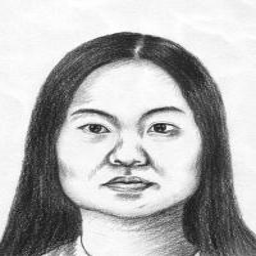

# 复现《基于空间自适应 Transformer 的人脸素描图像生成》

## 前言
使用部分数据复现论文试验方法和结果，复现脚本统一放置于 `scripts/`。

## 环境
- `venv`
- `Python 3.14.7`
- `CPU`

## 文件结构
```text
.
├── .gitignore                              # Git 忽略规则（排除数据集、虚拟环境、缓存、权重与根目录临时输入/输出）
├── 论文.md                                 # 目标复现论文完整文本（浙江大学学报工学版 2026, 60(9): 1953-1961）
├── README.md                               # 复现方法、脚本说明与阶段性测试结果记录
├── test.py                                 # 原版 StyTR-2 推理脚本（读取 input/ 生成迁移图，输出 .jpg）
├── train.py                                # 原版 StyTR-2 训练入口脚本
├── function.py                             # 特征归一化与通道均值/标准差计算工具（normal / calc_mean_std）
├── sampler.py                              # 训练数据无限采样器 InfiniteSamplerWrapper
├── scripts                                 # 复现脚本目录
│   ├── prepare-cuhk.py                     # 按人脸编号精准配对 CUHK 数据并统一 Resize 到 256×256（40 训 / 10 测）
│   ├── dataset_cuhk.py                     # PyTorch 配对数据读取器 PairedCUHKDataset，返回 (Ic, Is) 张量
│   ├── dfdm.py                             # 双模态特征解耦模块 DFDM×3 实现与前向/反传测试
│   └── vdfm.py                             # 行-列向量动态融合模块 VDFM×3 实现与生成器链路测试
├── cuhk-face-sketch-database               # 原始 CUFS 数据集
│   ├── photos                              # 188 张原始人脸照片（200×250）
│   └── sketches                            # 188 张对应人脸素描（200×250）
├── data
│   ├── cuhk                                # 40 训 / 10 测 迷你数据集 (256×256)
│   │   ├── train
│   │   │   ├── photo                       # 40 张训练照片
│   │   │   └── sketch                      # 40 张训练素描
│   │   └── test
│   │       ├── photo                       # 10 张测试照片
│   │       └── sketch                      # 10 张测试真值素描（仅用于对比/算分）
│   └── baseline                            # 原版 StyTR-2 在 CUHK 上的基线试验归档
│       ├── input                           # 基线试验输入（content 照片 + style 参考素描）
│       └── output                          # 基线生成结果（.jpg）
├── experiments                             # 原版预训练权重（decoder / embedding / transformer / vgg_normalised .pth）
├── Figure                                  # 原版 StyTR-2 示意图
├── input                                   # 单次推理临时工作区（已清空待下次试验）
│   ├── content                             # 待迁移照片
│   └── style                               # 参考风格图
├── models                                  # 原版 StyTR-2 网络定义
│   ├── StyTR.py                            # PatchEmbed、VGG19 编码器、decoder 解码器与基础损失函数
│   ├── transformer.py                      # 3 层编码器 / 3 层解码器 Transformer 及位置嵌入
│   ├── ViT_helper.py                       # ViT 辅助函数（DropPath、to_2tuple、trunc_normal_）
│   └── sampler.py                          # 模型侧采样辅助模块
├── out                                     # 推理输出临时工作区（已清空待下次试验）
└── util                                    # 原版通用工具库
    ├── box_ops.py                          # 边界框工具函数
    ├── misc.py                             # NestedTensor 与分布式辅助工具
    └── plot_utils.py                       # 训练曲线绘图工具
```

## 步骤
1. 构建 `StyTR-2` 环境，修改代码为 AMD/CPU 可用，使用原版 `test.py` 验证可用性。
2. 下载 CUFS（CUHK）数据集：https://www.kaggle.com/datasets/arbazkhan971/cuhk-face-sketch-database-cufs
   仅使用 `photos/`（188 张，200×250）与 `sketches/`（188 张，200×250）；`cropped_sketch/` 与 `original_sketch/` 属于 CUFSF，暂不使用。
3. 使用 `scripts/prepare-cuhk.py` 从 `photos/` 与 `sketches/` 按人脸编号精准配对，抽取 40 对训练 + 10 对测试（统一 Resize 为 `256×256` RGB），输出到 `data/cuhk/`。
   - 对应论文 **2.1 节**数据集划分（CUHK 188 对按 4:1 轻量化缩减）与 **1.5.4 节公式 (12)** 同人同尺寸约束。
   - 使用原版 `test.py` 跑 1 张测试照片 + 1 张训练素描，输入与输出归档到 `data/baseline/`，对应论文 **2.2 节图 4** 的基线对照组。

   | 输入照片 $I_c$ | 风格参考 $I_s$（训练集） | 原版基线输出（`data/baseline/output/`） | 测试真值素描（仅对比） |
   | :---: | :---: | :---: | :---: |
   |  |  |  |  |

4. 使用 `scripts/dataset_cuhk.py` 构建配对数据读取器 `PairedCUHKDataset`（输出张量 `[B, 3, 256, 256]`，像素范围 `[0, 1]`）。
   - 对应论文 **1.1 节**双分支输入（人脸照片 $I_c$、素描图像 $I_s$）与 **1.5.4 节公式 (12)** 像素对齐要求。

   | 训练照片 $I_c$ | 对应训练素描 $I_s$ |
   | :---: | :---: |
   |  |  |

5. 使用 `scripts/dfdm.py` 实现并测通 `DFDM×3`：内容分支 3 级最大池化（`3×3→2×2`）、风格分支 5 级渐进平均池化（`5×5→3×3`）、`13×13` 与 `3×3` 交替卷积、双线性插值回原尺寸后逐像素重加权，参数量 `8.95 M`。
   - 对应论文 **1.2 节**、**图 2**、**2.4.2 节**与 **2.4.3 节**。
6. 使用 `scripts/vdfm.py` 实现并测通 `VDFM×3`：对内容与风格特征通道拼接后做自注意力与线性投影，沿行/列做 $L_1/L_2/L_\infty$ 多范数聚合与指数门控双向融合，参数量 `14.96 M`，串联 `PatchEmbed -> DFDM×3 -> VDFM×3 -> decoder` 输出 `[1, 3, 256, 256]` 并完成梯度反传验证。
   - 对应论文 **1.3 节公式 (1)~(8)** 与 **图 1**。

## 原版 StyTR-2 已实现的论文部分
- `models/StyTR.py` (14~33 行) `PatchEmbed`：分块卷积嵌入（`patch_size=8`，`256×256 → 32×32×512`）→ 对应 **1.1 节**“分块卷积操作”与 **图 1**“嵌入”。
- `models/transformer.py` (48~50 行) `Transformer.forward`：内容自适应位置嵌入 → 对应 **图 1**“位置嵌入”。
- `models/transformer.py` (23~24 行) `encoder_c` / `encoder_s`：3 层双路自注意力编码器 → 对应 **图 1** 编码端的层归一化与自注意力骨架（层数与 `DFDM×3` 一致）。
- `models/StyTR.py` (36~66 行) `decoder`：3 次上采样卷积重建图像 → 对应 **1.1 节**轻量化解码器与 **图 1** 右侧重建端。
- `models/StyTR.py` (68~165 行) `vgg` / `enc_1..enc_5`：冻结的预训练 VGG19 特征提取 $\Phi(\cdot)$ → 对应 **1.5 节**特征空间约束。
- `models/StyTR.py` (209 行) `calc_content_loss`：VGG 第 4、5 层特征 MSE → 对应 **1.5.1 节公式 (9)** $L_C$（论文权重 7）。
- `models/StyTR.py` (211~213 行) `calc_style_loss`：5 层 VGG 均值 + 标准差 MSE → 对应 **1.5.2 节公式 (10)** $L_S$（论文权重 18）。
- `models/StyTR.py` (216~227 行) `loss_lambda1` / `loss_lambda2`：自重建身份损失（权重 70 与 1，与论文 **1.5.4 节公式 (12)(13)** 的 $\lambda_{ID1}=70$、$\lambda_{ID2}=1$ 一致，区别是论文改为直接约束生成图 $G_s$ 与配对 $I_c, I_s$）。
